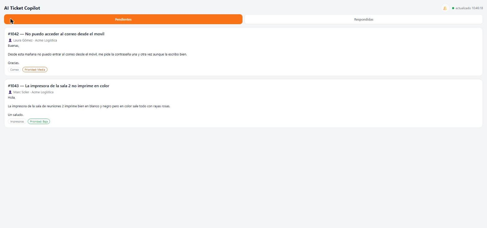
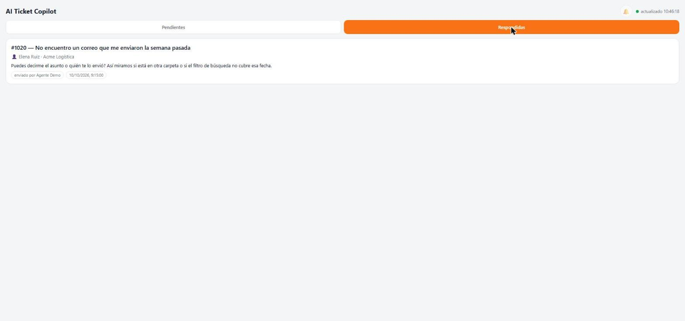

# SupportCandy AI Copilot

A WordPress plugin that drafts AI-generated reply suggestions for new [SupportCandy](https://supportcandy.net/) help desk tickets, and puts them in front of a human agent to review, edit and send from a small PWA (Progressive Web App) with push notifications — never sending anything to a customer automatically.

Built to sit on top of a production help desk with zero changes to SupportCandy itself, and to degrade gracefully: if OpenAI is unavailable or disabled, simple keyword-matched templates still cover the most common requests.

> Screenshots below use mock data — no real tickets, customers or company names.

**A ticket open in the PWA, with the three AI-drafted reply options:**

**Pending drafts waiting for an agent:**

**Sent replies history:**

## Why

A support team was spending a lot of agent time on repetitive first-touch replies (password resets, "my mailbox is full", "how do I set up an out-of-office reply", etc.) and on drafting the first clarifying question for less common tickets. The goal was to cut that time down without ever letting an LLM talk to a customer unsupervised.

## How it works

1. **New ticket comes in** (`wpsc_ticket_created` hook). A fixed set of keyword rules is checked first — zero cost, zero API call. If nothing matches, the ticket's subject, description, category, priority and customer name are sent to OpenAI with a tightly specified system prompt.
2. **The model returns three alternative replies** (not three difficulty levels — three independent, self-contained options an agent can send as-is), plus a confidence score and a `needs_human` flag, enforced via a strict JSON schema so the output is always parseable.
3. **The draft is stored as `pending`**, never sent. A push notification (Firebase Cloud Messaging) goes out to agents who've installed the PWA.
4. **The agent opens the PWA**, reviews the three options (or writes a custom reply), and sends, edits, or dismisses. Sending goes through SupportCandy's own `submit_ticket_thread()` so it behaves exactly like a native reply.
5. The plugin also fixes a gap in that flow: SupportCandy's own "change ticket status after an agent reply" setting is applied by its admin UI, not by the lower-level function this plugin calls directly — so after sending, the plugin re-applies that configured status itself (see the comments in `cai_rest_send_reply()` for how this was diagnosed from SupportCandy's own source).

## Prompt design

The system prompt (in `supportcandy-ai-copilot.php`) isn't a single generic "be helpful" instruction — it encodes a style guide built from real agent feedback over time: tutear the customer, no corporate boilerplate, no opening `¿` (Spanish keyboards/agents consistently only use the closing `?`), no colons used as pseudo-bullet punctuation, don't claim to have done something that isn't in the ticket, and three structurally different (not escalating-difficulty) alternatives per ticket. It also has topic-specific sections (e.g. "email not found" tickets, connectivity/slowness tickets) added incrementally as patterns emerged, as a way of keeping the model's output anchored to what actually works for this team rather than what reads well in isolation.

## Stack

- **WordPress plugin (PHP)** — REST API (`/wp-json/ai-ticket-copilot/v1/...`) consumed by the PWA, OpenAI integration with a strict JSON schema response, direct SQL only where SupportCandy's own PHP API doesn't expose what's needed (documented inline, with the reasoning).
- **PWA** (vanilla HTML/CSS/JS, no build step) — installable on a phone, polls + listens for push, Application Password auth against the WordPress REST API.
- **Firebase Cloud Messaging** — push notifications, including background delivery via a service worker.
- **OpenAI** — draft generation with `response_format: json_schema` (`strict: true`) and `reasoning_effort: low` to keep latency and cost down for what's a short, well-specified task.

## Setup

1. Copy this folder into `wp-content/plugins/` on a WordPress site running [SupportCandy](https://wordpress.org/plugins/supportcandy/), and activate it.
2. Create a Firebase project (for push notifications), enable Cloud Messaging, and:
   - Replace the placeholder `CAI_FIREBASE_*` constants near the top of `supportcandy-ai-copilot.php`.
   - Replace the matching `FIREBASE_CONFIG` block in `pwa/index.html` and `pwa/sw.js`.
   - Generate a service account key (Project settings → Service accounts) and copy `firebase-service-account.example.php` to `firebase-service-account.php`, filling in the real values. This file is gitignored on purpose — never commit it.
3. In `pwa/index.html`, point `SITE_URL` at your WordPress site (or leave it blank and let agents set it from the PWA's own login screen).
4. In WP admin, go to **Settings → AI Ticket Copilot** and add an OpenAI API key.
5. Create a WordPress [Application Password](https://make.wordpress.org/core/2020/11/05/application-passwords-integration-guide/) for an agent account, install the PWA (it's installable straight from the browser — `pwa/index.html`), and log in with that.

## What's intentionally not in this repo

Real Firebase project credentials, the real OpenAI key, and any ticket/customer data — this is the sanitized version of a plugin that ran against a real help desk. See `.gitignore` and the `.example.php` files for what to fill in yourself.
